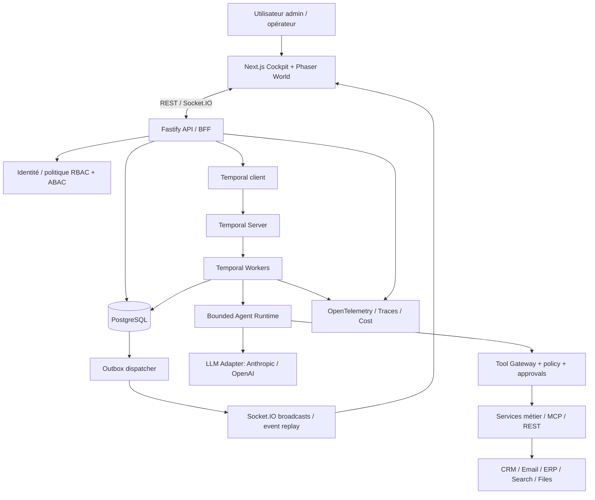

# 02 — Architecture technique et organisation du code

## 1. Découpage conceptuel


**Ne pas confondre trois étages :** (a) orchestration métier durable via Temporal ; (b) raisonnement agent borné, appelé comme activité ; (c) animation de monde via projection d'événements métier. La map n'a pas besoin de « savoir » comment les LLM raisonnent.

## 2. Stack de référence
- **Langage :** TypeScript strict, Node.js stable LTS, pnpm workspace + éventuellement Turborepo uniquement si besoin de cache (ne pas l'imposer au M0).
- **Frontend :** Next.js App Router, React, Tailwind, composants accessibles, **Phaser 4** pour tilemap isométrique, asset sprites, navigation caméra, avatars et animations. Tester la compatibilité Phaser avec Next : le monde doit être initialisé **client-side only** via import dynamique, détruit proprement en unmount et n'essaie jamais de s'exécuter dans SSR.
- **API :** Fastify + Zod, OpenAPI généré/aligné, Socket.IO server ; HTTP pour commandes/snapshots, WebSocket pour flux.
- **Back :** Prisma + PostgreSQL ; jobs Temporal TS dans un processus distinct ; OTel + Pino + traces LLM.
- **Agent runtime :** interface `LLMProvider`, adaptateurs Anthropic/OpenAI (l'un suffit au départ), `AgentRunner` avec boucle maximale, validation de chaque appel outil, politique en dehors des prompts. Ne pas superposer LangGraph + Temporal inutilement.
- **Outils :** `ToolRegistry` + `ToolGateway` ; adaptateur `MockTool` déterministe en démo ; adaptateurs MCP/HTTP pour live. Exécuter les outils à risque dans un environnement isolé et à capacités réduites ; pas de shell arbitraire en prod.
- **Infra locale :** Docker Compose PostgreSQL + Temporal (et dépendances Temporal si nécessaires), apps lancées en Node. Configurer CORS et cookies proprement. Event bus initial via outbox Postgres, **pas besoin de Kafka/NATS au MVP**.

## 3. Structure à générer par Claude Code
```text
/
  CLAUDE.md
  README.md
  START_HERE.md
  docs/  specs/  examples/
  apps/
    web/
      src/app/ ...
      src/components/{cockpit,panels,world,common}/...
      src/features/{agents,tasks,tools,meetings,approvals}/...
      src/lib/{api,socket,store}/...
      public/assets/{tiles,avatars,icons,maps}/...
    api/
      src/{server,plugins,routes,services,auth,realtime,events}/...
    worker/
      src/{worker,workflows,activities,schedules}/...
  packages/
    contracts/   # Zod types, command/event/snapshot schemas
    db/          # Prisma schema, migrations, seeds, repositories
    agents/      # runner, prompts versionnés, provider adapters, guardrails
    policies/    # checks auth/permissions, approval rules, budgets
    tools/       # registry, gateway, demo/real adapters
    world/       # projection de state vers directions/animations
    ui/          # React shared components si pertinent
  infra/
    docker-compose.yml
    docker/
    observability/
  tests/
    e2e/
    integration/
  scripts/
  package.json
  pnpm-workspace.yaml
  tsconfig.base.json
  .env.example
  .github/workflows/ci.yml
```
Les chemins sont une référence, pas une obligation de créer des dossiers vides. Code lean, domaines séparés par package, pas de centralisation artificielle.

## 4. Frontend dataflow
1. Login/init récupère `GET /v1/bootstrap` : snapshot cohérent, `lastSeq`, droits UI, provenance.
2. Connecte Socket.IO, authentifié, et demande `events:resume(lastSeq)`.
3. Reducer idempotent applique uniquement séquences suivantes ; événements dupliqués ignorés ; trou de séquence → `GET /v1/events?afterSeq=...` ou refetch snapshot.
4. Phaser reçoit une projection **pure** (ex. `visualIntent: {agentId, targetAnchor:'finance_desk_02', animation:'work'}`), anime localement ; React affiche panneaux et KPI depuis store.
5. Une interaction utilisateur émet une commande HTTP `POST` avec `idempotencyKey`; seul le backend peut décider d'acceptation et produire l'événement.
6. Sur refresh / changement de navigateur : snapshot, reprise, replay des événements. Les avatars reprennent à leur position ou cible reconstruite, sans dédoubler les opérations métier.

## 5. Backend dataflow / transactional outbox
Pour chaque transition métier (dans une transaction DB) : vérifier version et permissions, mettre à jour l'agrégat, insérer `event_log`, insérer `outbox`, commit. Un dispatcher diffuse `outbox` ; n'indique livraison qu'après tentative réussie vers le broker (Socket.IO : plusieurs abonnés et replay possible). Au début, l'API peut scruter la table et émettre ; à plus grande échelle, avoir un worker séparé avec verrouillage `FOR UPDATE SKIP LOCKED`. **At least once** pour la diffusion : les clients dédupliquent par `eventId` et `sequence`.

Temporal pilote la durée métier, mais **aucune modification irréversible directement depuis le code Workflow**. Les `Activities` contiennent les I/O ; gérer timeouts, retry policies par classe d'erreur, cancellation, idempotence. Ne jamais inclure d'objets gigantesques ou secrets dans l'historique Temporal.

## 6. Temporal et données
Temporal s'occupe des processus (attente, retry, appels d'activités, escalade). PostgreSQL garde missions, résultats, consentements et états inspectables. Reconstituer `WorkflowState` métier depuis les agrégats, plutôt que de dépendre de l'UI Temporal. Un worker en panne doit pouvoir reprendre sans double effet (idempotency key unique par action logique).

## 7. Interfaces de services
- `AgentService`: create, activate, suspend, updateVersion, assignManager, attachCapabilities.
- `TaskService`: create, assign, transition, block, complete, cancel, dependencies.
- `WorkflowService`: start, signal, query, cancel ; nomenclature/versioning.
- `MeetingService`: propose, start, participantJoin, finish, summarize.
- `ToolService`: registry, authorize, invoke, record metrics.
- `PolicyService`: `can(actor, action, resource, context): Decision`.
- `ProjectionService`: snapshot, world state, KPI, timeline.
- `LLMService`: choose model, invoke, account usage.

## 8. Multi-tenant / sécurité frontières
Toutes les entités ont `org_id` dès le départ. Les queries métier sont scoppées à l'organisation du principal authentifié, avec tests de non-fuite. Pour MVP mono-org, implémenter un org par défaut et une identité administrateur **locale**, pas d'identifiants de prod. En live, OIDC; les outils agissent sous identités de service propres, permissions minimales. Ne jamais passer au navigateur les clés API d'outils ou fournisseurs.

## 9. Pourquoi cette architecture
- Une seule source de vérité (PostgreSQL) et une orchestration durable (Temporal) évitent les divergences.
- Le transport temps réel est **non fiable par défaut** : persistance + séquence + replay obligatoires.
- L'interface jeu est composable et interchangeable ; si Phaser plante, les agents continuent.
- L'ajout d'un nouveau département n'exige pas de refactor du moteur LLM.
- Les appels outil sont le bon point central pour appliquer sécurité, métriques et visualisation.

## 10. Définition du « scalable »
Pour 100 agents, ne faire tourner des modèles que quand une tâche le justifie ; agents « employés » = définition persistée, non processus permanent par avatar. Les statuts `idle` ne consomment pas de tokens. Les meetings sont des activités programmées, pas des conversations infinies. Fréquence Socket.IO limitée et agrégée, animations ~30/60 fps locales sans émission de positions côté serveur.
