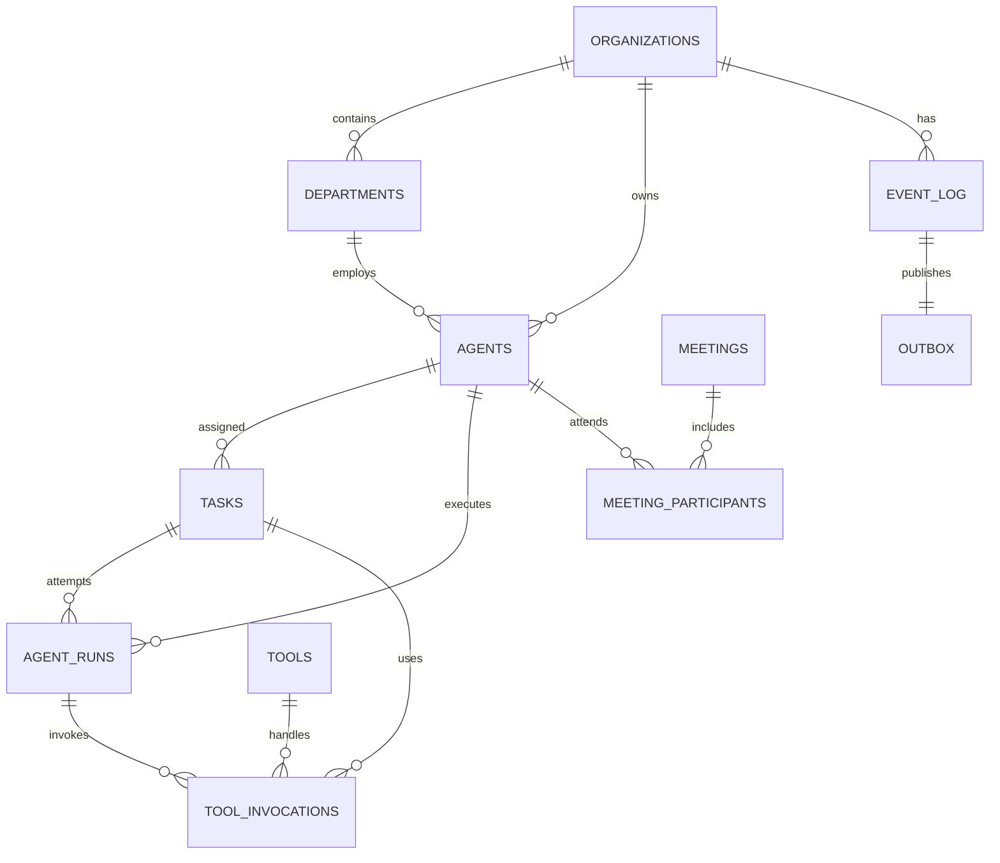

# 03 — Modèle de données, intégrité et transitions

## 1. Conventions
PostgreSQL/Prisma ; clés primaires `uuid` ou UUIDv7 si package stable ; toutes les dates UTC `timestamptz`, affichage local UI. `org_id` obligatoire sur presque toutes les tables. `created_at`, `updated_at`, `deleted_at` quand nécessaire, `version` pour concurrence optimiste. Texte long non sensible uniquement ; secrets dans vault/env, **jamais JSON de logs**. Clés étrangères et contraintes uniques explicites. Historique append-only pour événements et audit.

## 2. Tables minimales et champs essentiels
| Table | Champs / contraintes importants |
|---|---|
| `organizations` | id, name, mode, timezone, currency, created_at |
| `users` | id, provider_subject, display_name, created_at |
| `memberships` | org_id, user_id, role (`admin/operator/viewer`), unique(org_id,user_id) |
| `departments` | id, org_id, name, color, room_id, manager_agent_id nullable, capacity |
| `agents` | id, org_id, name, slug, department_id, manager_id nullable, status, current_task_id nullable, active_version_id, avatar_id, created_by, deleted_at |
| `agent_versions` | id, agent_id, version, instructions, model_policy_id, capability_set, immutable once activated |
| `capabilities` | id, org_id nullable, key, description, risk_class |
| `agent_capabilities` | agent_id, capability_id, constraints_json, scope, granted_by, expires_at |
| `tasks` | id, org_id, title, description, kind, status, priority, assigned_agent_id, requester_type/id, workflow_id, parent_task_id, due_at, provenance, idempotency_key, version |
| `task_dependencies` | task_id, depends_on_task_id, unique pair, reject cycles at service layer |
| `agent_runs` | id, agent_id, task_id, workflow_id, provider, model, status, step_count, started_at, ended_at, outcome_summary, failure_code, provenance |
| `workflow_instances` | id, org_id, type, version, temporal_workflow_id, status, current_step, task_id, started_at, ended_at |
| `meetings` | id, org_id, topic, initiator_agent_id, status, room_id, task_id, started_at, ended_at, summary, decision_json |
| `meeting_participants` | meeting_id, agent_id, joined_at, left_at, role, unique(meeting_id, agent_id) |
| `tools` | id, org_id nullable, key, name, category, icon, supported_actions_json, risk_class |
| `tool_connections` | id, org_id, tool_id, auth_reference, connection_status, last_checked_at, owner_user_id |
| `tool_invocations` | id, org_id, tool_id, connection_id, agent_run_id, agent_id, task_id, action, risk, status, redacted_input_json, redacted_output_summary, duration_ms, idempotency_key, attempts, created_at, ended_at, failure_code, provenance |
| `approval_requests` | id, org_id, actor_agent_id, resource_type/id, action, status, risk_reason, safe_preview_json, requested_at, deadline_at, reviewed_by, reviewed_at, decision_reason |
| `llm_usage` | id, org_id, agent_run_id, provider, model, input_tokens, output_tokens, cached_tokens, estimated_cost_minor, currency, measured_or_estimated, timestamp |
| `budgets` | id, org_id, scope_type/id, period, limit_minor, used_minor, currency, hard_stop, alert_threshold |
| `maps` | id, org_id, version, tilemap_asset, navmesh_version, is_active |
| `rooms` | id, map_id, department_id nullable, key, name, type, capacity, anchor_group_id |
| `avatar_profiles` | id, org_id, agent_id, sprite_key, variant_json, last_anchor, destination_anchor, facing, cosmetic_state |
| `event_log` | id, org_id, seq, type, aggregate_type/id, aggregate_version, correlation_id, causation_id, actor, provenance, payload_json, schema_version, occurred_at; unique(org_id,seq) |
| `outbox` | id, org_id, event_id, status, attempts, next_attempt_at, created_at, published_at; unique(event_id) |
| `audit_log` | id, org_id, timestamp, actor_type/id, action, resource_type/id, result, trace_id, data_classification, redacted_details, hash_chain optional |
| `idempotency_keys` | org_id, key, operation, response_ref, status, created_at, expires_at; unique(org_id,key,operation) |

**Pragmatisme :** au M0/M1, créer seulement les tables indispensables (org/users/departments/agents/tasks/tools/invocations/event_log/outbox/rooms), puis ajouter les autres suivant le jalon ; conserver la cohérence des noms et relations.

## 3. Diagramme des relations principales

## 4. Statuts + transitions autorisées
**Agents :** `draft -> active -> paused -> active -> deactivated`. `deactivated` ne redevient `active` que par action admin auditée. `working`, `thinking`, `using_tool`, `in_meeting`, `waiting_approval` sont des **états d'activité dérivés** (ne pas les confondre avec activation administrative).

**Tasks :** `created -> queued -> running -> (waiting_approval | blocked | succeeded | failed | cancelled)` ; `blocked -> queued` via reprise ; `failed -> queued` uniquement via nouvelle tentative explicitement identifiée ; `succeeded` terminal. Toutes transitions invalides rejetées côté serveur. Pour multi-étapes, `progress` basé sur étapes réellement terminées.

**Invocations :** `requested -> authorized -> (waiting_approval | running | rejected) -> (succeeded | failed | timed_out | cancelled)` ; `rejected` terminal ; `waiting_approval -> running` seulement après décision validée ; requêtes side effect idempotentes.

**Meetings :** `proposed -> scheduled -> in_progress -> completed`; alternative `cancelled` depuis proposé/programmé, `failed` depuis actif. Participants requis dans une réunion démarrée ; résultat structuré persistant.

**Approval :** `pending -> approved | rejected | expired | cancelled`. Une décision est terminale et versionnée. Double-clic admin ne déclenche pas deux actions.

## 5. Événement métier et causalité
Enveloppe définie en `specs/events.schema.json`, exemple en `examples/agent-tool-cycle.json`. Un même run partage `correlationId`, les descendants utilisent `causationId`. `seq` monotone **par org**, pour la reprise Socket. `eventId` unique. `payload` strict par `type` dans les contrats Zod TypeScript ; le JSON schema fourni définit l'enveloppe globale, pas tout le mapping spécifique. Payload redacted avant stockage dans le flux UI.

## 6. Transactions et concurrence
- Pour allouer un desk, verrouiller la ressource ou utiliser `unique(room_id, anchor_id)` sur les affectations actives : deux avatars ne peuvent pas avoir le même poste.
- `tasks.version` protège les transitions concurrentes.
- `outbox.event_id` garantit qu'un événement de domaine n'est pas créé deux fois par le même commit.
- `tool_invocations.idempotency_key` est unique par org+outil+action logique ; certaines API externes ne prennent pas en charge l'idempotence : prévoir une vérification d'effet (lookup) avant retry.
- Les tâches enfant ont un DAG ; détecter les cycles avant insertion.
- Les achats/transactions exigent confirmation transactionnelle métier, pas simple sortie textuelle d'agent.

## 7. Index, rétention, sécurité
Index recommandés : `tasks(org_id,status,created_at)`, `tool_invocations(org_id,status,created_at)`, `agents(org_id,department_id,status)`, `event_log(org_id,seq unique)`, `agent_runs(task_id,started_at)`, `approvals(org_id,status,requested_at)`, `outbox(status,next_attempt_at)`. Éventuels partitions après mesure. Politique de rétention configurable pour traces détaillées ; conserver agrégats et décisions nécessaires ; RGPD pour données personnelles avec minimisation et droits de purge/masquage des payloads. Ne pas supprimer des preuves de façon non contrôlée.

## 8. Démo reproductible
Fixtures seed **12 agents**, **7 départements** + café, **8 outils** (CRM, Email, Drive, Browser/Search, ERP, Analytics, ATS, Docs), **3 workflows** et **une approbation d'exemple**. `provenance: demo` sur tout objet, événement et invocation. Seed relançable sans doublons, horloge déterministe configurable pour tests et scénarios. Un outil démo est un vrai adaptateur au niveau de la `ToolGateway` avec résultat fictif, jamais un appel réseau externe.
