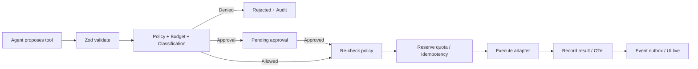

# 05 — Catalogue d'outils, permissions, validation humaine, sécurité

## 1. L'outil est une entité de première classe
Les outils doivent être **visibles dans le cockpit** et centralisés en backend. Modèle : `ToolDefinition` (catégorie, icône, contrat, actions, classe de risque), `ToolConnection` (connexion autorisée à une org, credentials en vault), `ToolInvocation` (agent, tâche, action, argument redacted, statut, timestamps, retries, résultat redacted, latence), `ToolPolicy` (qui peut quoi), `ApprovalRequest` (décision humaine).

Catalogue démo : CRM, Gmail-like Email (simulation, pas Gmail réel), Browser/Search (fixtures locales), Documents, Drive-like Files, ERP/Billing, ATS, Analytics. Catégories : communication, données, finance, web, documents, création, développeur, coordination. Prévoir icônes SVG originales ou libres vérifiées ; ne pas incorporer logo propriétaire sans droit/licence.

## 2. Contrat d'outil (`ToolDefinition`)
```ts
type Risk = 'read'|'internal_write'|'external_write'|'high_impact';
type ToolSpec<I, O> = {
  key: string; name: string; category: string;
  action: string; risk: Risk;
  inputSchema: z.ZodType<I>;
  outputSchema: z.ZodType<O>;
  requiredCapabilities: string[];
  invoke(ctx: ToolExecutionContext, input: I): Promise<O>;
};
```
Chaque adaptateur MCP/REST est encapsulé derrière `ToolGateway.invoke`. Le LLM **n'accède jamais directement** aux SDK d'outils avec credential. `ToolGateway` résout connexion, vérifie policy, examine arguments, applique quota et approval, puis délègue à adapter. Tous les flux d'usage d'outils transitent par ce composant pour pouvoir être affichés.

## 3. Matrice des risques par défaut
| Type d'action | Exemple | Politique par défaut |
|---|---|---|
| `read` | lire prospect CRM autorisé | auto si grant valide |
| `internal_write` | ajouter note interne brouillon | auto si grant et ressource dans scope |
| `external_write` | envoyer email client, publier post | approval sauf politique explicitement approuvée dans un périmètre précis |
| `high_impact` | paiement, suppression, signature, modification droits/secret, prod deploy | humain obligatoire + contrôle fort ; jamais en demo |

**Risque réel = action + cible + valeur + classification des données**. Une lecture peut être haut risque si elle touche des données RH confidentielles ; des permissions ne sont pas autorisées uniquement via une simple liste de noms d'outils.

## 4. Sécurité des secrets et données
- Connexions sous comptes de service dédiés, scopes minimaux et rotation.
- Secrets côté serveur en variables d'environnement pour dev, vault/KMS pour prod.
- Pas de clés ni tokens dans PostgreSQL en clair, prompts, payloads Socket.IO ou consoles.
- Ne jamais journaliser corps intégral d'email, CV, facture contenant PII dans la timeline. Stocker `safe_preview` / hash / référence artefact et consulter contenu complet sous autorisation spécifique si nécessaire.
- Classification `public`, `internal`, `confidential`, `restricted` ; masquage adapté à chaque audience.
- Prompt injection : traiter données entrantes comme non fiables, séparer instructions système et contenu outil ; pas d'escalade en réponse à un document, email ou page web.
- Désactiver terminal, browser automation avec écriture et accès au disque du développeur en LIVE tant qu'un sandbox et policy détaillés ne sont pas en place.
- Protéger SSRF : allowlists d'hôtes, interdiction métadonnées cloud/IP privées pour outils HTTP, pas de requête arbitraire au nom de l'agent.
- Permissions vérifiées **à chaque invocation**, même si UI avait affiché un outil comme disponible.

## 5. Approbations
`approval.requested` : suspend activité, stocke type d'action, auteur, outil, arguments **aperçu redacted**, raison/risque, montant/ressource si pertinent, échéance, idempotence ; `pending` affiché dans KPI et inspecteur. Un opérateur habilité approuve/rejette depuis API. La reprise est un **signal Temporal** et doit réévaluer permission, budget, ressource et validité au moment de l'exécution (éviter TOCTOU). Journaliser identifiant approbateur et décision ; désactiver validation automatique par le même agent requérant.

## 6. Budgets et coûts
Limiter par organisation, département, agent, tâche et outil ; préautoriser une réserve avant appel modèle, puis concilier montant effectivement consommé et restituer reliquat. Budget hard limit bloque nouvelles requêtes, soft limit notifie. Logger provider/model/version, tokens input/output/cache si disponibles, tarif paramétrable, coût en centimes **mesuré vs estimé**. Ne jamais diviser par zéro ni afficher « coût exact » si le fournisseur ne donne pas assez d'informations. Les prix des LLM évoluent : **pas de tarif figé dans le code**, config versionnée et horodatée.

## 7. Contrôles d'exécution
`maxSteps` (ex. 12), `maxDelegations` (5), `timeout` (5 minutes), `perRunBudget` paramétrables. Retries différenciés : timeout lecture = retry possible ; `send_email` sans idempotence externe = vérifier l'effet avant retry. Circuit breaker pour outils instables. Rate limiting par org, acteur et connexion. On hard stop, workflow conserve état `blocked`; jamais de nouveau paiement automatique ou publication non autorisée.

## 8. Cycle de vie d'une invocation

Émettre `tool.invocation.requested/started/succeeded/failed/rejected` avec statuts respectifs. Le frontend doit mesurer la durée depuis les timestamps de l'invocation persistée, pas deviner des activités à partir d'un timer UI.

## 9. Gestion des utilisateurs
Rôles initiaux : `admin`, `operator`, `viewer`. `viewer` ne peut ni déclencher outil ni approuver ; `operator` peut créer tâches non sensibles, agir sur son périmètre ; `admin` contrôle config et approbations, sauf séparation de devoirs requise ultérieurement. Auth locale simple pour MVP mais production sous OIDC + cookies sécurisés/CSRF/CORS/headers et TLS. **Aucun endpoint d'admin non authentifié en production.** Les tests incluent 401/403 et cross-tenant.

## 10. Protection produit
L'univers virtuel ne sert pas à contourner l'auth : cliquer sur « lancer une réunion », « recruter » ou « connecter un outil » déclenche les mêmes contrôles que l'API. Les usages critiques disposent de confirmations dans l'UI et d'indications explicites « action réelle ». Un utilisateur ne peut pas manipuler les coordonnées de l'avatar pour obtenir l'accès à une salle/ressource protégée.
